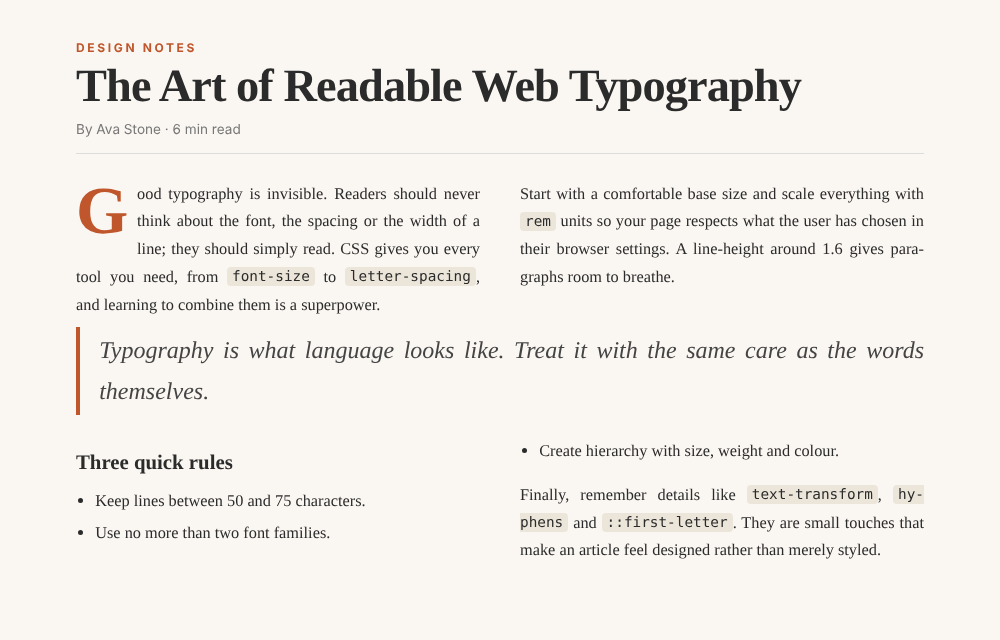
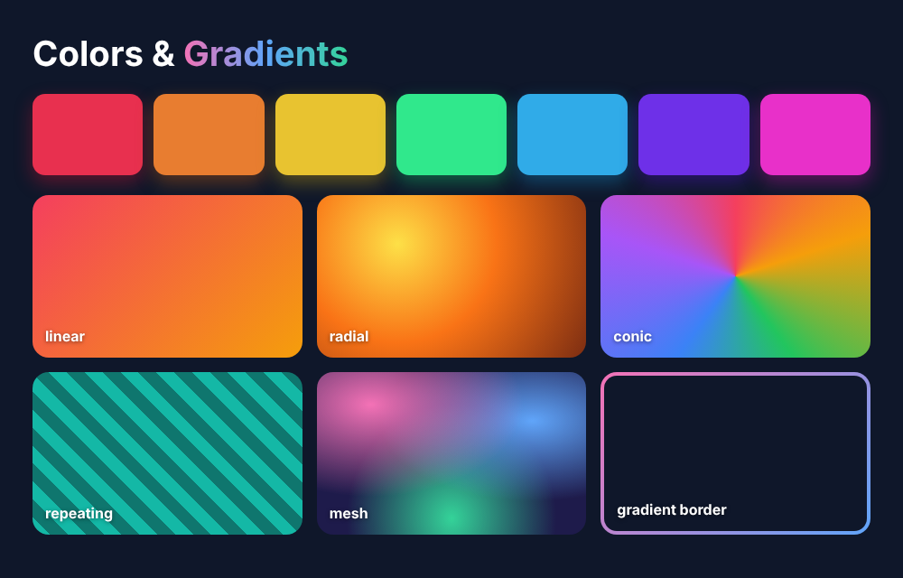
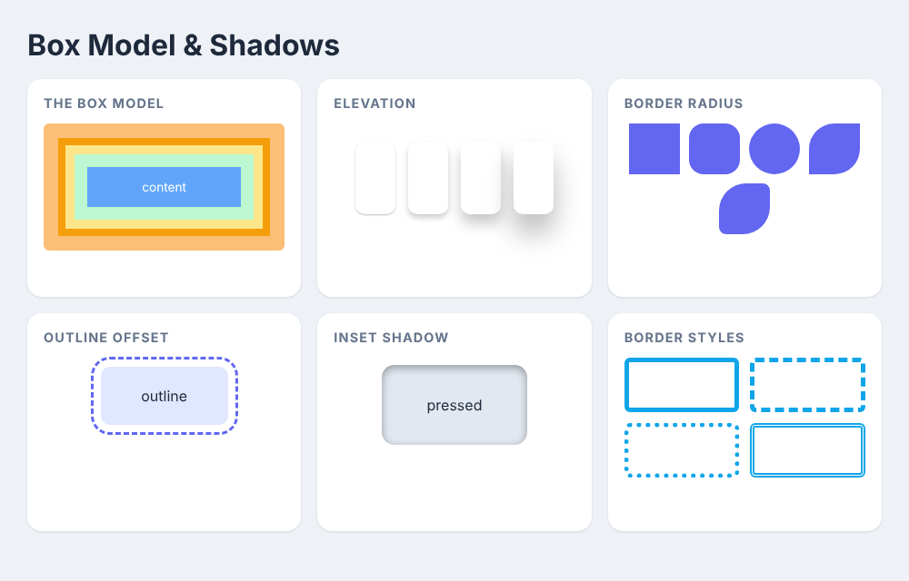

# html-css

24 hands-on CSS templates with full source code, covering typography, colors, box model, Flexbox, Grid, positioning, forms, variables, filters, transitions, keyframes and 3D transforms.

Open any folder's `index.html` in your browser. 16 are static layouts and 8 are animated (GIF previews below).

## Templates

| #   | Template                                                                  | Type     | CSS topics                                                                     |
| --- | ------------------------------------------------------------------------- | -------- | ------------------------------------------------------------------------------ |
| 01  | [Typography & Article](01-typography/)                                    | static   | font-family, rem, line-height, ::first-letter, columns                         |
| 02  | [Colors & Gradients](02-colors-gradients/)                                | static   | hsl(), custom properties, linear / radial / conic gradient                     |
| 03  | [Box Model, Borders & Shadows](03-box-model-shadows/)                     | static   | margin, padding, border, box-shadow, outline, border-radius                    |
| 04  | [Flexbox Landing Page](04-flex-landing/)                                  | static   | display:flex, justify-content, align-items, gap, flex-wrap                     |
| 05  | [CSS Grid Photo Gallery](05-grid-gallery/)                                | static   | grid-template-columns, repeat(), minmax(), grid-column span, gap               |
| 06  | [Grid Template Areas Dashboard](06-grid-areas-dashboard/)                 | static   | grid-template-areas, fr units, nested grid, overflow                           |
| 07  | [Positioning: Badges, Tooltips & Ribbons](07-positioning/)                | static   | position: relative / absolute / sticky, z-index, inset, transform              |
| 08  | [Responsive Pricing Cards](08-responsive-pricing/)                        | static   | @media, clamp(), min(), auto-fit grid, :nth-child, transform                   |
| 09  | [Modern Form Styling](09-form-styling/)                                   | static   | :focus, :placeholder-shown, :valid, accent-color, appearance                   |
| 10  | [Dark Mode with CSS Variables](10-dark-mode-variables/)                   | static   | :root, var(), prefers-color-scheme, [data-theme], toggle switch                |
| 11  | [Glassmorphism & CSS Filters](11-glassmorphism-filters/)                  | static   | backdrop-filter, filter, blur(), rgba, mix-blend-mode                          |
| 12  | [Pseudo-elements & Counters](12-pseudo-elements/)                         | static   | ::before, ::after, content, attr(), counter-increment, :nth-child              |
| 13  | [Table Styling](13-table-styling/)                                        | static   | border-collapse, :nth-child(even), position: sticky, :hover, badges            |
| 14  | [Bento Grid](14-bento-grid/)                                              | static   | grid-template-columns, grid-area spans, aspect-ratio, overflow, gradients      |
| 15  | [Clip-path & Shapes](15-clip-path-shapes/)                                | static   | clip-path: polygon / circle / inset, border-radius blobs, aspect-ratio         |
| 16  | [Pure-CSS Tabs & Accordion](16-tabs-accordion/)                           | static   | :checked, sibling combinator ~, 
, ::marker, max-height                |
| 17  | [Button Hover Transitions](17-button-hover-transitions/)                  | animated | transition, :hover, transform, ::before, box-shadow, ease                      |
| 18  | [Keyframe Loaders & Spinners](18-keyframe-loaders/)                       | animated | @keyframes, animation, infinite, animation-delay, transform-origin             |
| 19  | [3D Card Flip](19-3d-card-flip/)                                          | animated | perspective, transform-style: preserve-3d, backface-visibility, rotateY        |
| 20  | [Animated Gradient & Shimmer Text](20-animated-gradient-hero/)            | animated | background-size, background-position, background-clip: text, float animation   |
| 21  | [CSS Typing Effect](21-typing-effect/)                                    | animated | steps(), ch unit, border-right caret, overflow hidden, animation timing        |
| 22  | [Hamburger Menu & Slide-in Drawer](22-hamburger-drawer/)                  | animated | checkbox hack, transform: translateX, transition-delay, ~ sibling, X icon      |
| 23  | [Solar System Orbits](23-solar-system/)                                   | animated | rotate, transform-origin, animation-duration, border-radius, nested elements   |
| 24  | [Marquee, Progress Bars & Skeleton Loader](24-marquee-progress-skeleton/) | animated | translateX loop, width animation, linear-gradient shimmer, animation-fill-mode |

## Animated previews

### Button Hover Transitions

Six hover effects built with transition: grow, slide-fill, growing underline, arrow nudge, lift and glow pulse. The core of micro-interactions.

### Keyframe Loaders & Spinners

Six looping loaders: spinner, bouncing dots, equalizer bars, pulse ring, flipping square and indeterminate progress.

### 3D Card Flip

Cards that flip in 3D to reveal a back face. Learn perspective, preserve-3d and backface-visibility.

### Animated Gradient & Shimmer Text

A moving gradient background, shimmering headline, drifting blobs and a pulsing button. Four animations layered together.

### CSS Typing Effect

A typewriter headline using only CSS: width animates in discrete steps while a caret blinks.

### Hamburger Menu & Slide-in Drawer

A hamburger icon that morphs into an X and a drawer that slides in with staggered menu items. No JavaScript.

### Solar System Orbits

Planets orbiting a sun at different speeds. Each orbit is a rotating wrapper with a planet offset from the centre.

### Marquee, Progress Bars & Skeleton Loader

Three common animated patterns: an infinite logo marquee, progress bars that fill, and a skeleton card with a shimmer.

## Static previews

### Typography & Article

### Colors & Gradients

### Box Model, Borders & Shadows

### Flexbox Landing Page

### CSS Grid Photo Gallery

### Grid Template Areas Dashboard

### Positioning: Badges, Tooltips & Ribbons

### Responsive Pricing Cards

### Modern Form Styling

### Dark Mode with CSS Variables

### Glassmorphism & CSS Filters

### Pseudo-elements & Counters

### Table Styling

### Bento Grid

### Clip-path & Shapes

### Pure-CSS Tabs & Accordion

